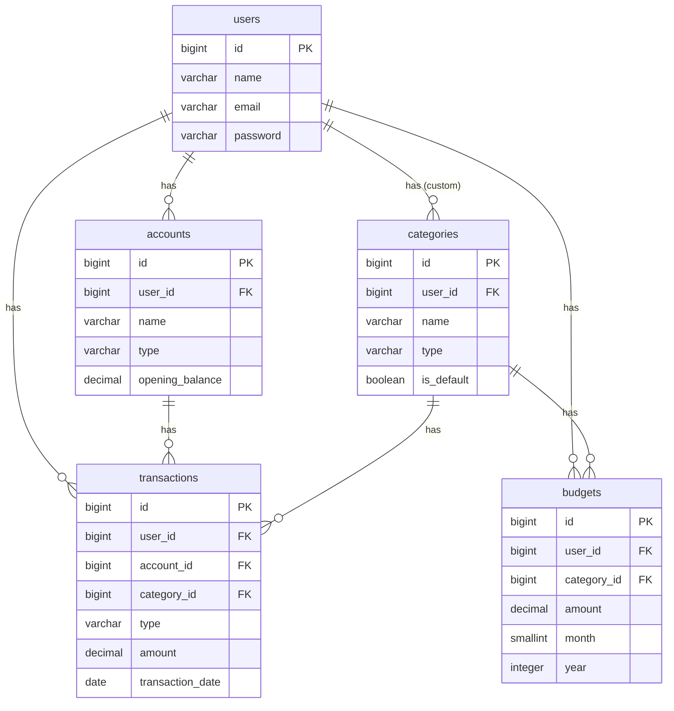

# Database Design – AI Finance Manager

**Status:** MVP Finalized  
**Last Updated:** 2026-10-06  
**Database:** PostgreSQL  
**Design Principle:** Simple for MVP, easily expandable for future features

---

## 1. MVP Tables (Phase 1)

We will start with only these **5 core tables**.

### 1.1 users

| Column       | Data Type       | Constraints                  | Description                  |
|--------------|-----------------|------------------------------|------------------------------|
| id           | BIGSERIAL       | PRIMARY KEY                  | Unique user ID               |
| name         | VARCHAR(100)    | NOT NULL                     | Full name                    |
| email        | VARCHAR(150)    | NOT NULL, UNIQUE             | Login email                  |
| password     | VARCHAR(255)    | NOT NULL                     | Hashed password              |
| created_at   | TIMESTAMP       | DEFAULT NOW()                |                              |
| updated_at   | TIMESTAMP       | DEFAULT NOW()                |                              |

---

### 1.2 accounts

| Column           | Data Type       | Constraints                  | Description                              |
|------------------|-----------------|------------------------------|------------------------------------------|
| id               | BIGSERIAL       | PRIMARY KEY                  |                                          |
| user_id          | BIGINT          | NOT NULL, FK → users.id      | Owner of the account                     |
| name             | VARCHAR(100)    | NOT NULL                     | e.g. HDFC Salary, Cash, Paytm            |
| type             | VARCHAR(30)     | NOT NULL                     | bank / cash / credit_card / wallet       |
| opening_balance  | DECIMAL(15,2)   | NOT NULL DEFAULT 0           | Starting balance                         |
| currency         | VARCHAR(10)     | NOT NULL DEFAULT 'INR'       |                                          |
| is_active        | BOOLEAN         | NOT NULL DEFAULT TRUE        | Soft control (active/inactive)           |
| created_at       | TIMESTAMP       | DEFAULT NOW()                |                                          |
| updated_at       | TIMESTAMP       | DEFAULT NOW()                |                                          |

---

### 1.3 categories

| Column       | Data Type       | Constraints                  | Description                                      |
|--------------|-----------------|------------------------------|--------------------------------------------------|
| id           | BIGSERIAL       | PRIMARY KEY                  |                                                  |
| user_id      | BIGINT          | NULLABLE, FK → users.id      | NULL = System default category                   |
| name         | VARCHAR(100)    | NOT NULL                     | e.g. Food, Salary, Gym                           |
| type         | VARCHAR(20)     | NOT NULL                     | income / expense                                 |
| icon         | VARCHAR(50)     | NULLABLE                     | Optional icon name                               |
| color        | VARCHAR(20)     | NULLABLE                     | Optional color code                              |
| is_default   | BOOLEAN         | NOT NULL DEFAULT FALSE       | TRUE for system categories                       |
| created_at   | TIMESTAMP       | DEFAULT NOW()                |                                                  |
| updated_at   | TIMESTAMP       | DEFAULT NOW()                |                                                  |

**Note:**  
- System default categories → `user_id = NULL` and `is_default = TRUE`  
- User custom categories → `user_id = <user_id>` and `is_default = FALSE`

---

### 1.4 transactions

| Column            | Data Type       | Constraints                  | Description                          |
|-------------------|-----------------|------------------------------|--------------------------------------|
| id                | BIGSERIAL       | PRIMARY KEY                  |                                      |
| user_id           | BIGINT          | NOT NULL, FK → users.id      | Who owns this transaction            |
| account_id        | BIGINT          | NOT NULL, FK → accounts.id   | Which account                        |
| category_id       | BIGINT          | NOT NULL, FK → categories.id | Which category                       |
| type              | VARCHAR(20)     | NOT NULL                     | income / expense                     |
| amount            | DECIMAL(15,2)   | NOT NULL                     | Always stored as positive number     |
| transaction_date  | DATE            | NOT NULL                     | Date of transaction                  |
| note              | TEXT            | NULLABLE                     | Optional note                        |
| created_at        | TIMESTAMP       | DEFAULT NOW()                |                                      |
| updated_at        | TIMESTAMP       | DEFAULT NOW()                |                                      |

**Important Rule:**  
- `amount` is always positive.  
- Use `type` column to know if it is income or expense.

---

### 1.5 budgets

| Column       | Data Type       | Constraints                  | Description                          |
|--------------|-----------------|------------------------------|--------------------------------------|
| id           | BIGSERIAL       | PRIMARY KEY                  |                                      |
| user_id      | BIGINT          | NOT NULL, FK → users.id      |                                      |
| category_id  | BIGINT          | NOT NULL, FK → categories.id |                                      |
| amount       | DECIMAL(15,2)   | NOT NULL                     | Budget limit for the month           |
| month        | SMALLINT        | NOT NULL                     | 1 to 12                              |
| year         | INTEGER         | NOT NULL                     | e.g. 2026                            |
| created_at   | TIMESTAMP       | DEFAULT NOW()                |                                      |
| updated_at   | TIMESTAMP       | DEFAULT NOW()                |                                      |

**Unique Constraint (Recommended):**  
`(user_id, category_id, month, year)` → One budget per category per month.

---

## 2. Relationship Diagram (Text + Mermaid)

### Simple Text Diagram

```
users
  ├── accounts          (1 user → many accounts)
  ├── categories        (1 user → many custom categories)
  ├── transactions      (1 user → many transactions)
  └── budgets           (1 user → many budgets)

accounts
  └── transactions      (1 account → many transactions)

categories
  ├── transactions      (1 category → many transactions)
  └── budgets           (1 category → many budgets)
```

### Mermaid Diagram (can be viewed in any Mermaid supported tool)



---

## 3. Future Upgradability Plan

The current design is intentionally simple so we can add new features later without breaking existing tables.

| Future Feature                  | How we will upgrade                                      | New Table / Change Needed                  |
|---------------------------------|----------------------------------------------------------|--------------------------------------------|
| Transfer between Accounts       | Create new table `transfers`                             | `transfers` table                          |
| Recurring Transactions          | Create new table `recurring_transactions`                | `recurring_transactions` table             |
| Attach Receipt / Image          | Add column `receipt_path` in `transactions`              | Column addition                            |
| Soft Deletes                    | Add `deleted_at` column in required tables               | Column addition                            |
| Family / Shared Access          | Create `family_groups` + `family_members` tables         | New tables                                 |
| Goals & Savings                 | Create `goals` table                                     | New table                                  |
| Tags                            | Create `tags` + `transaction_tag` (pivot) tables         | New tables                                 |
| AI Insights                     | Create `ai_insights` table                               | New table                                  |
| Debt / Loan Tracker             | Create `debts` or `loans` table                          | New table                                  |
| Multi-currency advanced         | Already supported via `currency` column                  | Minimal change                             |
| Roles & Permissions             | Create `roles` + `permissions` + pivot tables            | New tables                                 |

---

## 4. Current Balance Calculation Logic (Important)

We will **not** store current balance in the `accounts` table permanently.

Current Balance of an account =  

```
Opening Balance
+ SUM of all Income transactions
- SUM of all Expense transactions
```

This approach is cleaner and avoids data inconsistency.

---

## 5. Indexes (Recommended for Performance)

We should add these indexes later for better speed:

- `accounts(user_id)`
- `categories(user_id)`
- `transactions(user_id)`
- `transactions(account_id)`
- `transactions(category_id)`
- `transactions(transaction_date)`
- `budgets(user_id, month, year)`

---

## 6. Summary

- **MVP uses only 5 tables**
- Design is clean and normalized
- Easy to expand for all planned future features
- No over-engineering at this stage

---

**Next Step after this document:**  
Authentication flow + API structure discussion.
